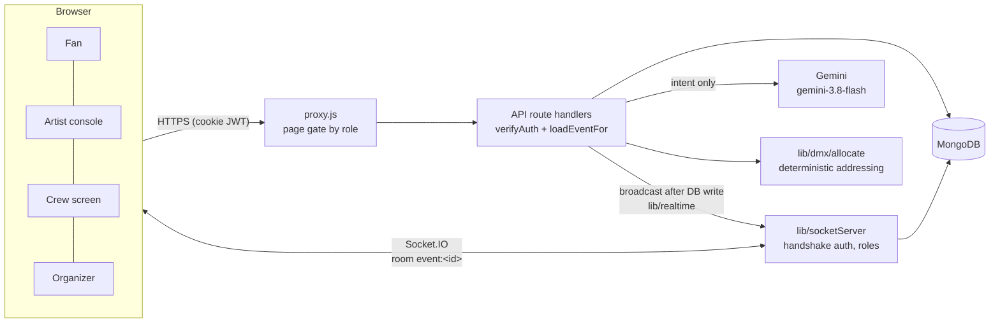

# StageVerse


A live-event platform that connects the four groups behind a concert: **fans**, **artists**, **organizers** and the **production crew**. Organizers publish shows, artists build setlists, tech riders and day sheets, crews patch lighting and track logistics, and during the show the artist's console, the crew's screens and fans' phones stay in sync in real time, including a live encore vote.

Built with Next.js 16 (App Router), MongoDB/Mongoose, Socket.IO and Google Gemini.

## What each role can do

| Role | Highlights |
|---|---|
| **Fan** | Discover events, predict the setlist (scored after the show), vote in the live encore poll, memory vault |
| **Artist** | Setlist builder, encore polls, live-show console (start/pause/last-song alert), tech rider with LD assignment, day sheet, guest list |
| **Organizer** | Create and manage events, AI-written event descriptions, reports and analytics |
| **Production crew** | Live cue screen synced to the artist, DMX patch studio with an AI patch assistant, logistics board, tasks |

## Architecture



- **Every API route authenticates and authorizes itself.** A user's permissions on an event come from their *relation* to it (organizer / artist / assigned crew), not just their account role ([`lib/authz.js`](lib/authz.js)). The page proxy only decides which pages a role can open.
- **The server is the source of truth for live state.** Clients request changes over HTTP; the server writes to MongoDB and *then* broadcasts to the show's Socket.IO room. Details, sequence diagram and numbers: [`docs/live-sync.md`](docs/live-sync.md).
- **The LLM interprets, code computes.** The DMX patch assistant asks Gemini only for intent (`{action, fixtures:[{type,count}]}`, JSON-schema constrained and validated, with one repair retry). A deterministic allocator assigns collision-free addresses ([`lib/dmx`](lib/dmx)).

## Run it locally (about 10 minutes)

**Prerequisites:** Node.js 22, a MongoDB database (local `mongod` or a free Atlas cluster), and optionally a Gemini API key for the AI features.

```bash
git clone https://github.com/Priyanshh1407/StageVerse.git
cd StageVerse
npm install
cp .env.example .env.local      # then fill in MONGODB_URI and JWT_SECRET (GEMINI_API_KEY optional)
npm run seed -- --yes           # demo users, venue, event and setlist
npm run dev                     # http://localhost:3000
```

Demo accounts created by the seed script (password `password123`):

| Role | Email |
|---|---|
| Fan | `fan@stageverse.demo` |
| Artist | `artist@stageverse.demo` |
| Organizer | `organizer@stageverse.demo` |
| Production crew | `production@stageverse.demo` |

To see the live sync, open the artist's live-show page, the crew's live page and the fan dashboard for the seeded event in three browser windows.

## Scripts

| Command | What it does |
|---|---|
| `npm run dev` / `build` / `start` | Next.js dev server / production build / production server |
| `npm test` | Full test suite against an in-memory MongoDB replica set (no network, no real DB) |
| `npm run test:coverage` | Tests with a coverage report for server code |
| `npm run lint` | ESLint (CI fails on any error) |
| `npm run seed -- --yes` | Seed demo data into the database in `.env.local` |
| `npm run bench` | Live-screen benchmark (endpoint latency, socket push latency) |
| `npm run eval:patch` | AI patch-assistant evaluation, legacy vs current pipeline (makes ~60 real Gemini calls; `-- --fake` checks the harness without API calls) |

## Testing and quality

- **173 tests** (Vitest) covering authentication, an authorization matrix across roles and routes (including the cases that *must* still be allowed), voting integrity (20 concurrent votes from one fan count once), socket handshake auth and room isolation against a real Socket.IO server, prediction scoring, input validation, rate limiting, the DMX allocator (with property-based tests over random patches), and the AI patch route with a scripted model.
- **CI** ([`.github/workflows/ci.yml`](.github/workflows/ci.yml)) runs lint, tests with coverage, a production build and a dependency audit on every push.
- The engineering history (each bug, how it was found, the fix and the trade-off) is in [`FIX_LOG.md`](FIX_LOG.md). The audit that started it is in [`PROJECT_AUDIT_REPORT.md`](PROJECT_AUDIT_REPORT.md).

## Measured

| What | Result | Source |
|---|---|---|
| Live-state requests, 10 crew screens | 10/s → 0.5/s (push first, 20 s reconcile) | `bench/results/` |
| Socket push latency to 10 screens | p50 ≈ 3 ms, p95 ≈ 5 ms | `bench/results/` |
| Setlist lookup | 2,001 → 1 documents examined (index) | `bench/results/` |
| Production dependency advisories | 19 → 1 (`xlsx`, write-only use, not reachable) | `npm audit --omit=dev` |

## Known limitations

Written down on purpose: this is a portfolio project, and these are the honest edges.

- **Ticketing is on hold.** The purchase widget has a known crash (BUG-01), purchases don't issue tickets (BUG-02), and inventory updates aren't atomic (BUG-03). No real payments are taken. See "Parked: Ticketing" in [`UPGRADE_PLAN.md`](UPGRADE_PLAN.md).
- **Real-time needs one long-running Node server.** Socket.IO attaches to Next's HTTP server, so it doesn't work on serverless hosts, and rooms are in-process (multiple instances would need the Socket.IO Redis adapter).
- **Rate limits are per process** (in-memory token buckets).
- **Gemini free tier is tight:** 5 requests/minute and 20 requests/day per model. The app falls back from `gemini-3.8-flash` to `gemini-3.6-flash` when the primary is overloaded or out of quota, but heavy AI use needs a billed API key.
- **Accounts choose their own role at signup.** Fine for a demo; a real deployment would approve organizer and crew accounts.
- **Sentiment analysis isn't built.** The analysis page shows labelled sample data.
- The AI patch evaluation harness exists, but its real-model results haven't been recorded yet: a full run needs ~60–70 calls per model, more than the free tier's 20 per day.

## Project structure

```
app/            pages (grouped by role) and API route handlers (app/api)
components/     UI components by area
lib/            auth, authorization, errors, validation schemas, realtime, socket server, DMX allocator, LLM client
models/         Mongoose schemas
pages/api/socket/io.js   Socket.IO bootstrap (needs the Node server)
tests/          Vitest suites (unit, security, characterization)
bench/ evals/   performance benchmark and LLM evaluation harness
docs/           design notes
```
