<p align="center">
  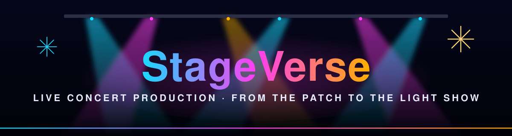
</p>

<h1 align="center">⚡ StageVerse</h1>
<p align="center"><b><i>Bridging live event production and systems engineering</i></b></p>
<p align="center">Designed and built by <a href="https://www.linkedin.com/in/priyansh-waghela-3b754b282/"><b>Priyansh Waghela</b></a></p>

<p align="center">
  <a href="https://stage-verse.vercel.app/"></a>
  
</p>
<p align="center">
  
  
  
  
  
  
  
  
  
</p>

<p align="center">
  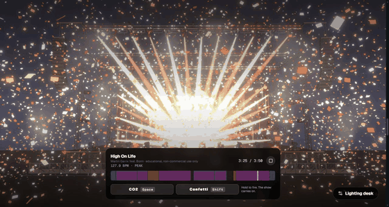<br>
  <sub><b>The homepage's fireworks finale</b>, programmed automatically from the song: confetti, streamers and CO2 on the first beat, then stage pyro, then shells chosen bar by bar by how loud the music is.</sub>
</p>

StageVerse is a full-stack platform for live concert production that connects the four groups behind a show: **fans**, **artists**, **organizers** and the **production crew**. Organizers publish shows, artists build setlists, tech riders and day sheets, crews patch lighting and track logistics, and during the show the artist's console, the crew's screens and fans' phones stay in sync in real time, including a live encore vote. The homepage is a 3D festival with four stages, where any song is analysed in the browser and turned into a light show. It aims to cut the technical overhead, signal collisions and communication gaps of concert production for technical directors, systems engineers and front-of-house (FOH) crews.

**Live site: [stage-verse.vercel.app](https://stage-verse.vercel.app/)** | [LinkedIn](https://www.linkedin.com/in/priyansh-waghela-3b754b282/)

### Try it live

On the [login page](https://stage-verse.vercel.app/login), press **Try as Fan / Artist / Organizer / Crew** to sign in with one click, or type one of these demo accounts (password `stageverse-demo`). They share one demo tour, so you can see the same shows from every side:

| Role | Email | Start here |
|---|---|---|
| Fan | `recruiter.fan@stageverse.demo` | Dashboard (Watch the stage live), Discover, Memories, Friends |
| Artist | `recruiter.artist@stageverse.demo` | Tour dashboard, setlist builder, tech rider, live show control |
| Organizer | `recruiter.organizer@stageverse.demo` | Dashboard on real data (shows, artists booked, crews, cities), create an event with AI copy |
| Production crew | `recruiter.crew@stageverse.demo` | Production dashboard, DMX patch studio (one show has an address clash to find; View on stage), logistics board |

For the live sync, log in as the artist and the crew in two browser windows (one private), open the same show's live pages and start the show. The demo data is reset regularly.

Built with Next.js 16 (App Router), MongoDB/Mongoose, Socket.IO, React Three Fiber and Google Gemini.

---

## 🛠️ Core engineering features

### 1. Patch studio with collision-free DMX addressing
Manually assigning DMX addresses across many multi-channel moving heads invites errors that can stall a load-in.
* **The logic:** a deterministic allocator ([`lib/dmx`](lib/dmx)) places each fixture's channel footprint inside 512-channel universes (first fit), never splitting a fixture across a universe boundary, and a conflict check flags any overlapping footprints before anything is saved.
* **AI assistant:** a patch request in plain words ("patch 6 spots and 4 washes") goes to the LLM only for *intent*; the allocator computes the addresses, so collisions are impossible by construction (measured below).

### 2. Real-time FOH-to-backstage sync
Live shows change fast; the artist's console, the crew's cue screens and fans' phones must stay in lockstep.
* **The tech:** Socket.IO rooms per show, authenticated at the handshake with the session cookie.
* **The logic:** the server is the source of truth: clients request changes over HTTP, the server writes to MongoDB and *then* broadcasts to the show's room (p50 ≈ 3 ms push latency to 10 screens).
* **The show clock** is stored with the show (seconds banked plus when the current run started), so a screen that opens late or presses refresh is on the right second ([`docs/live-sync.md`](docs/live-sync.md)).

### 3. 🎆 The homepage: a 3D festival you can run
A scroll-driven 3D festival that runs at 56–60 FPS on integrated graphics. The visit starts at a venue gate and a live stage (64 moving heads, 8 lasers, an LED wall, line arrays, sub stacks), then the camera walks out through the gate to three more stages, each an original design and each the home of a genre and a persona: a **warehouse** club (rap, the Organizer), a **desert** stage with a sunset sky and giant side screens (pop and Bollywood, the Fan) and a **mainstage** with winged LED fins (EDM, the Artist). One stage is lit at a time; the camera walks between them at eye level, and every scroll, key, swipe or dot click moves exactly one section, in either direction.

* **Any song becomes a light show.** Visitors play one of 10 demo songs or their own file, which is analysed in the browser (a Web Worker; it never leaves the device) with its genre's settings (tempo, beats, sections, chorus by repetition, vocals) and programmed the way a lighting designer would. Shows are written by fixture *role*, so any song plays on any stage, and each stage adds its own rules (the mainstage's 16 extra cues, the warehouse's club looks and circling camera).
* **Special effects on the music:** CO2 jets, confetti, streamers, stage pyro and a 30-second fireworks finale on the song's own beats; Space and Shift fire CO2 and confetti live.
* **A crowd with LED wristbands** (one instanced draw call) that bounces on the beat and raises its hands in the peaks, and a DJ or a band on stage.
* **Three camera views** during a song: Show, Audience, Artist (keys 1, 2, 3).
* **Run it yourself:** one-tap controls or a DMX-style lighting desk with a live DMX monitor (512 channel values per universe, patched by the project's own allocator, with the sACN packet bytes shown).
* **Share it:** a link to a song at a moment, a poster of the stage, and a "How it works" panel that shows the tempo, the section and why each cue fired.

Details: [`docs/homepage-show.md`](docs/homepage-show.md).

<table>
  <tr>
    <td width="50%">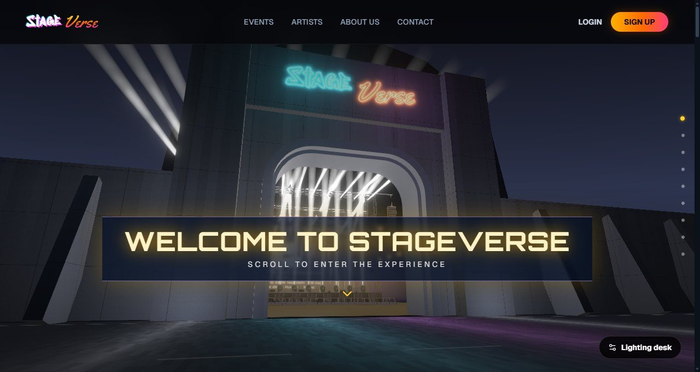<br><sub>🎟️ <b>The gate</b>: scroll to walk in</sub></td>
    <td width="50%">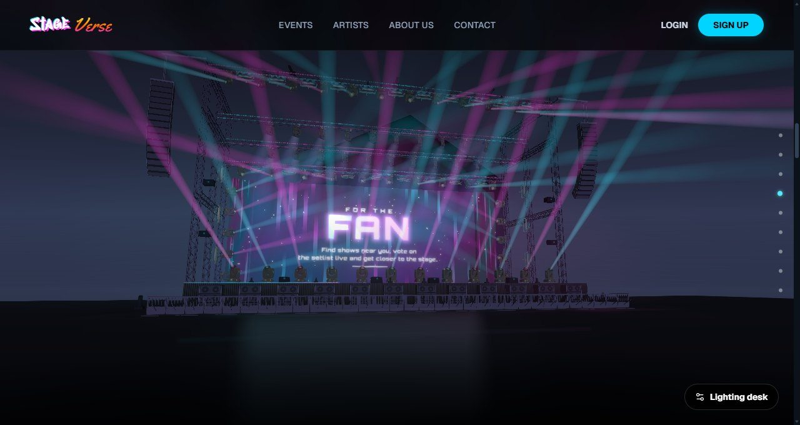<br><sub>💡 <b>The rig</b>: 64 moving heads, 8 lasers, an LED wall</sub></td>
  </tr>
  <tr>
    <td>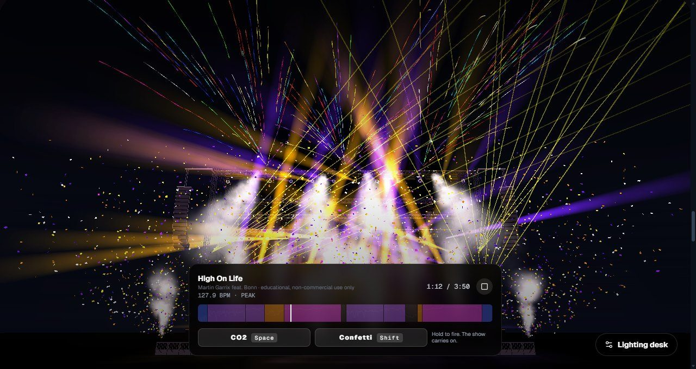<br><sub>🔊 <b>A drop</b>, programmed from the song's analysis</sub></td>
    <td>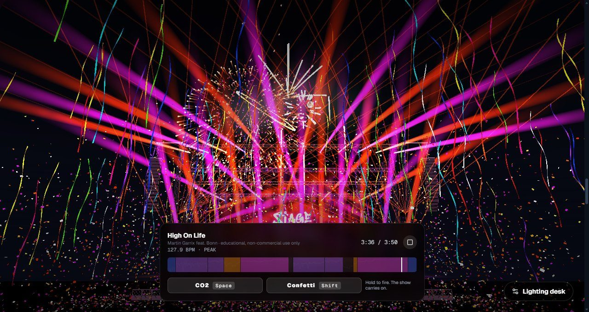<br><sub>🎆 <b>The finale</b>: shells, streamers and confetti</sub></td>
  </tr>
  <tr>
    <td>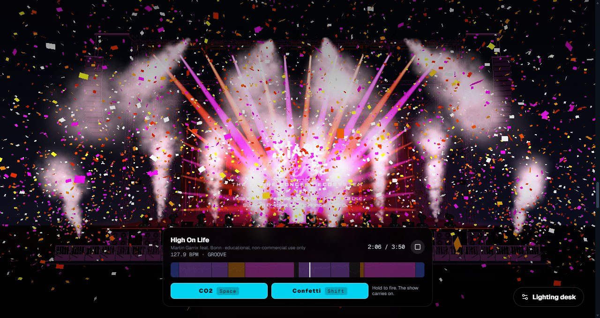<br><sub>💨 <b>Live keys</b>: hold Space for CO2, Shift for confetti, and the show carries on</sub></td>
    <td>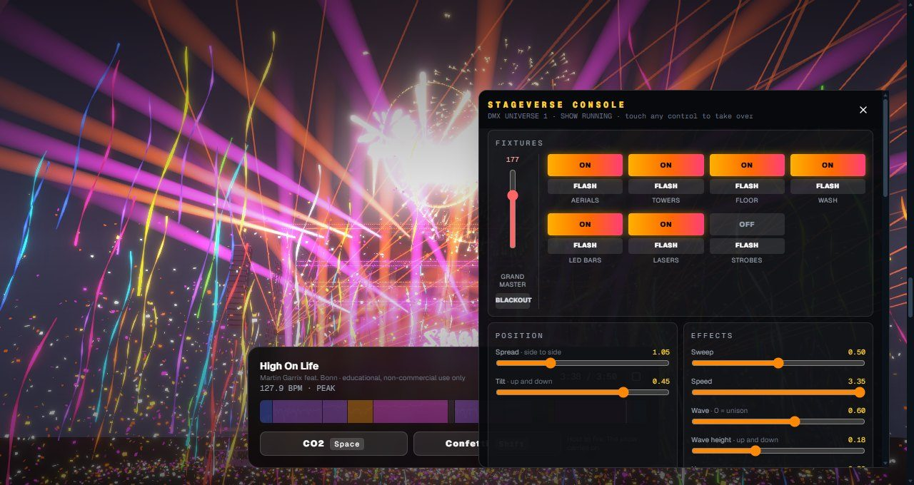<br><sub>🎛️ <b>The lighting desk</b>: run the lights, effects and fireworks yourself</sub></td>
  </tr>
</table>

<p align="center">
  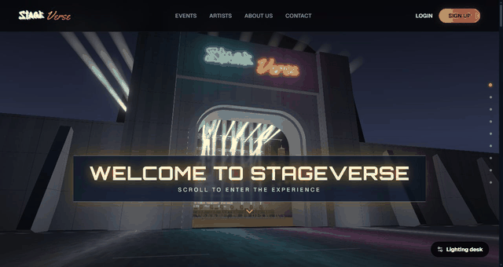
  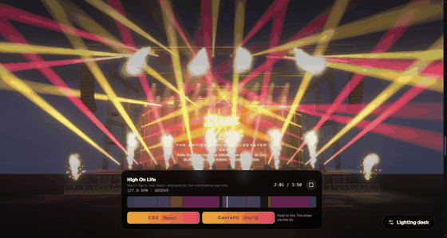<br>
  <sub>Left: the scroll journey from the gate to the rig. Right: CO2 and confetti fired live during a song.</sub>
</p>

### 4. grandMA3 patch export
The crew's patch sheet downloads the show's patch as a grandMA3 XML file ([`lib/patch/grandma3.js`](lib/patch/grandma3.js)), ready to import on a grandMA3 console. Lines with clashing or invalid addresses are left out and listed at the top of the file. It hasn't been test-imported on grandMA3 onPC yet.

## 🎭 What each role can do

| Role | Highlights |
|---|---|
| **Fan** | Dashboard, discover events, event pages with the ticket information, predict the setlist (scored after the show), vote in the live encore poll, watch the 3D stage follow the live show, memory vault, friends, direct messages, notifications |
| **Artist** | Setlist builder, encore polls, live-show console (start/pause/last-song alert), tech rider with LD assignment, day sheet, guest list |
| **Organizer** | Create and manage events (checked before sending, draft saved as you type, where the tickets are sold), AI-written event descriptions, a dashboard on real data |
| **Production crew** | Live cue screen synced to the artist, DMX patch studio with an AI patch assistant, grandMA3 export and the patch on a 3D stage, logistics board, tasks |

Every role's pages share one menu (`components/shell/RoleSidebar.jsx`). There is no ticket buying: an event page shows where its tickets are sold and a "Get tickets on <platform>" button.

---

## 🎨 Design

The whole site uses one palette taken from the logo: the sunset of "Verse" (amber `#ffb000` → orange `#ff6a00` → pink `#ff3d7a`) for main buttons and fills (the `sv-sunset` utility in `app/globals.css`), the logo's purple `#a855f7` for outlines, rings and focus, and white for labels. The 3D light show keeps its own full colour range. Event photos are renders of StageVerse's own three festival stages (`public/images/events`), picked by genre. Accessibility: no text under 12 px, every icon button named with a 44 px tap area, every field labelled.

## 🚀 Architecture

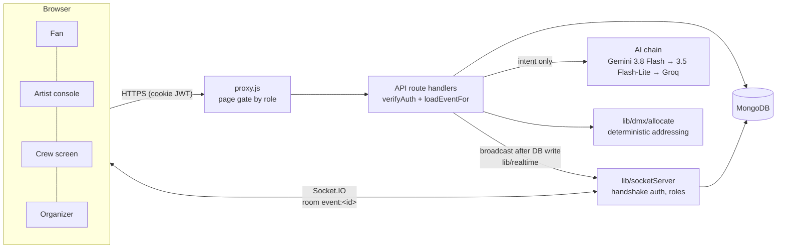

* **Frontend and API:** Next.js 16 (React 19) pages, with the API as Next.js route handlers (no separate Express server).
* **Database:** MongoDB via Mongoose.
* **Real-time layer:** Socket.IO attached to the Node server.
* **3D:** React Three Fiber / three.js.
* **Analytics:** Vercel Web Analytics (visitors, page views, referrers) plus named events for who tried the site: Try demo, Sign up, Play song, Light up own song, Open lighting desk, Get tickets.

Design decisions:
- **Every API route authenticates and authorizes itself.** A user's permissions on an event come from their *relation* to it (organizer / artist / assigned crew), not just their account role ([`lib/authz.js`](lib/authz.js)). The page proxy only decides which pages a role can open.
- **The server is the source of truth for live state.** Details, sequence diagram and numbers: [`docs/live-sync.md`](docs/live-sync.md).
- **AI requests are always answered.** Providers are tried in order (Gemini 3.8 Flash → Gemini 3.5 Flash-Lite → Groq `gpt-oss-120b`), and a provider that just hit overload or quota is skipped for a while (circuit breaker). If none answers, each feature falls back to something useful without AI: template copy, the artist's own song catalogue, a BPM energy curve for setlist order, or a rule-based reader for patch requests. Responses say `degraded: true` when that happens ([`lib/llm.js`](lib/llm.js)).
- **The LLM interprets, code computes.** The patch assistant asks the model only for intent (`{action, fixtures:[{type,count}]}`, JSON-schema constrained and validated, with one repair retry); the allocator assigns the addresses.
- **The 3D homepage fakes light instead of computing it.** Instanced real fixture models whose pan and tilt are solved in a vertex shader, additive cone beams (no real spotlights), each group of lights doing one job, the static stage merged into a few draw calls, shaders compiled before each part is shown, the same 64-head rig on every machine (stronger GPUs get sharper rendering), quality tiers with a live step-down and a 2D fallback. Four stages share one renderer and one show format; only the stage being visited is lit, and every effect is placed in its own stage's frame.

---

## ⚙️ Run it locally (about 10 minutes)

**Prerequisites:** Node.js 22.9 or newer, a MongoDB database (local `mongod` or a free Atlas cluster), and optionally Gemini and/or Groq API keys for the AI features (without any, AI features use their non-AI fallbacks).

```bash
git clone https://github.com/Priyanshh1407/StageVerse.git
cd StageVerse
npm install
cp .env.example .env.local      # then fill in MONGODB_URI and JWT_SECRET (GEMINI_API_KEY / GROQ_API_KEY optional)
npm run seed -- --yes           # demo accounts and a full demo tour (shows, tickets, crew, patches)
npm run dev                     # http://localhost:3000
```

Testing accounts created by the seed script (password `password123`; the seed also creates the recruiter accounts above):

| Role | Email |
|---|---|
| Fan | `fan@stageverse.demo` |
| Artist | `artist@stageverse.demo` |
| Organizer | `organizer@stageverse.demo` |
| Production crew | `production@stageverse.demo` |

To see the live sync, open the artist's live-show page, the crew's live page and the fan dashboard for the seeded event in three browser windows.

**Deploying:** the site runs on Vercel. [`docs/DEPLOYMENT.md`](docs/DEPLOYMENT.md) covers environment variables, MongoDB Atlas, shipping and rolling back, seeding production and the checks to run after a deploy.

## 📜 Scripts

| Command | What it does |
|---|---|
| `npm run dev` / `build` / `start` | Next.js dev server / production build / production server |
| `npm test` | Full test suite against an in-memory MongoDB replica set (no network, no real DB) |
| `npm run test:e2e` | Playwright browser tests: public pages and every role's screens (needs a seeded database) |
| `npm run test:coverage` | Tests with a coverage report for server code |
| `npm run lint` | ESLint (CI fails on any error) |
| `npm run seed -- --yes` | Seed demo data into the database in `.env.local` |
| `npm run bench` | Live-screen benchmark (endpoint latency, socket push latency) |
| `npm run demos` | Analyse every demo song in `public/audio/<genre>/` with its genre's settings and write the shows and `public/shows/index.json` |
| `npm run analyse:song -- <file> <slug> <title>` | Analyse one song (tempo, beats, sections) and program its homepage light show ([docs](docs/homepage-show.md)) |
| `npm run song:bars -- <file>` | Bar-by-bar loudness, drum density, brightness and bass of a song, for annotating its structure by hand |
| `npm run score:analysis` | Score the song analysis against the hand-marked test set in `tests/songs/` (each song as EDM and as its own genre) |
| `npm run eval:patch -- --provider groq` | AI patch-assistant evaluation, legacy vs current pipeline (~65 real API calls; `-- --fake` checks the harness without API calls) |

## 🧪 Testing and quality

- **495 tests in 45 files** (Vitest) covering authentication, an authorization matrix across roles and routes (including the cases that *must* still be allowed), voting integrity (20 concurrent votes from one fan count once), socket handshake auth and room isolation against a real Socket.IO server, prediction scoring, input validation, rate limiting, the DMX allocator (with property-based tests over random patches), the AI patch route with a scripted model, the grandMA3 export, and the homepage show: song analysis (against a synthetic click track), genre analysis (synthetic pop, rap and Bollywood songs), the cue engine, every lighting-programming rule, the strobe/blinder light, the scroll stops, the special effects and fireworks (the finale follows each song's beats, loudness, genre and tempo; shells are kept for the finale), the live CO2/confetti keys, the loading screen, the festival stages (every stage has its roles, lights and effect mounts; every walk between stages stays clear of walls; the homepage and the test pages put the camera in the same place; every mainstage cue is used), the role homes and the safe return path after login.
- **Browser tests** (Playwright, `e2e/`): public pages, the shared link, social card, robots and sitemap, and every role logging in and opening each of its screens; a CI job runs them against a seeded MongoDB container.
- **CI** ([`.github/workflows/ci.yml`](.github/workflows/ci.yml)) runs lint, tests with coverage, a production build and a dependency audit on every push.
- **Manual test guide:** [`docs/MANUAL_TESTING.md`](docs/MANUAL_TESTING.md) walks through every upgraded feature in the browser (including how to force each AI fallback level) and lists the automated test commands.
- The engineering history (each bug, how it was found, the fix and the trade-off) is in [`FIX_LOG.md`](FIX_LOG.md). The audit that started it is in [`PROJECT_AUDIT_REPORT.md`](PROJECT_AUDIT_REPORT.md).

## 📊 Measured

| What | Result | Source |
|---|---|---|
| Live-state requests, 10 crew screens | 10/s → 0.5/s (push first, 20 s reconcile) | `bench/results/` |
| Socket push latency to 10 screens | p50 ≈ 3 ms, p95 ≈ 5 ms | `bench/results/` |
| Setlist lookup | 2,001 → 1 documents examined (index) | `bench/results/` |
| Production dependency advisories | 19 → 1 (`xlsx`, write-only use, not reachable) | `npm audit --omit=dev` |
| AI patching: cases with colliding DMX addresses | 17% → **0%** (30-case eval, Groq gpt-oss-120b) | `evals/patch/results/` |
| AI patching: request understood correctly | 90% → **100%** (93% before one round of prompt fixes) | `evals/patch/results/` |
| AI patching: p50 / p95 latency | 1.3 / 2.1 s → **0.78 / 1.5 s** | `evals/patch/results/` |
| Homepage 3D stage on Intel Iris Xe (integrated) | ~89 real lights → 3 cheap fills; **60 FPS**, 58 FPS 1% low with bloom at native resolution (beams and truss); **56–60 FPS** at every scroll stop with the full stage, PA and 64 moving heads | `bench/results/stage-*.json`, [docs](docs/homepage-show.md) |
| Song analysis: tempo | *A Sky Full of Stars* 125.1 BPM (published 125); *Yellow* 86.8 BPM (published ~87) | [docs](docs/homepage-show.md) |
| Song analysis: pop by genre vs the EDM analysis | boundaries 38% → 53%, chorus 25% → 59%, peaks 64% → 65% (hand-marked songs) | `npm run score:analysis` |

## ⚠️ Known limitations

Written down on purpose: this is a portfolio project, and these are the honest edges.

- **No ticketing.** StageVerse doesn't sell tickets: an event page shows the ticket information and a button to the platform that sells them, which says buying from here is coming soon. The old purchase code (with its known bugs BUG-01 to BUG-03) is no longer reachable; its pages redirect.
- **Real-time needs one long-running Node server.** Socket.IO attaches to Next's HTTP server, so its pushes don't work on serverless hosts like Vercel, where the live screens fall back to re-syncing every 20 seconds and on refresh ([deployment guide](docs/DEPLOYMENT.md#7-known-limits-on-vercel)). Rooms are in-process (multiple instances would need the Socket.IO Redis adapter).
- **Rate limits are per process** (in-memory token buckets).
- **Free AI tiers are tight** (Gemini: 5 requests/minute and 20/day per model). The provider chain and non-AI fallbacks keep features working, but fallback answers are simpler; heavy AI use needs a billed key.
- **Accounts choose their own role at signup.** Fine for a demo; a real deployment would approve organizer and crew accounts.
- **Demo songs.** The 10 demo songs (listed in the [disclaimer](#-disclaimer)) are commercial recordings, committed only so the homepage demo works and used for educational purposes only; any other track stays local (gitignored). Their programmed shows and hand-marked structures are in `public/shows/` (`<slug>.show.json`, `<slug>.extras.json`). "Light up your song" analyses any MP3/WAV/OGG/FLAC in the visitor's browser without uploading it.
- **Genre analysis is measured on few songs.** The genre settings were tuned on hand-marked pop songs; rap and Bollywood are checked on synthetic songs only until real ones are marked in `tests/songs/`. Vocal detection is a rough signal-processing cue (no ML model): good enough to drive lighting, not a transcription.
- **Sentiment analysis isn't built.** The analysis page shows labelled sample data.
- **Phones get a lighter homepage.** The scroll show plays, but the playground (songs, desk) is one plain card with a link to open on a computer.
- **Custom analytics events** need a Vercel plan that includes them; visitors and page views work on every plan.
- The AI patch eval uses 30 cases I wrote, and the second prompt version was tuned on them, so its 100% intent accuracy is optimistic; a held-out case set is the next step. Gemini results are pending: the free tier's 20 requests/day per model is less than one full run.

## 📄 Disclaimer

This is a non-commercial portfolio project built for learning. The songs used in the homepage demo (*A Sky Full of Stars* and *Yellow* by Coldplay; *Closer* by The Chainsmokers feat. Halsey; *High On Life* by Martin Garrix feat. Bonn; *Smack That* by Akon feat. Eminem; *BAND4BAND* by Central Cee & Lil Baby; *goosebumps* by Travis Scott; *Subha Hone Na De* from *Desi Boyz*, music by Pritam; *Tu Meri* from *Bang Bang!*, music by Vishal-Shekhar; *Uff Teri Adaa* from *Karthik Calling Karthik*, music by Shankar-Ehsaan-Loy) are used for **educational, non-commercial purposes only**, to demonstrate the song analysis and light-show programming. All rights to the music belong to its respective owners (the artists, songwriters and labels). No ownership is claimed and nothing is sold. If you are a rights holder and want a track removed, contact me on [LinkedIn](https://www.linkedin.com/in/priyansh-waghela-3b754b282/) and it will be taken down. Fixture models and fonts are used under their own licences (see Credits).

## 🗺️ Roadmap

- [x] Collision-free DMX allocation with overlap checks, and an AI patch assistant on top of it.
- [x] Real-time show sync over Socket.IO with server-authoritative state.
- [x] 3D homepage concert with song analysis and automatic light-show programming.
- [x] Genre-aware song analysis (EDM, pop, rap, Bollywood) with a scored, hand-marked test set.
- [x] Special effects on the homepage stage: CO2 jets (floor and truss), confetti, streamers, stage pyro and a song-driven fireworks finale, on the desk, in every song and in uploads (flames and cold sparks were tried and dropped).
- [x] GrandMA3 patch export: the patch sheet downloads the patch as grandMA3 XML (`lib/patch/grandma3.js`; lines with clashes or bad addresses are left out and listed in the file). Not yet test-imported on grandMA3 onPC.
- [x] Live DMX monitor on the desk: the 512 values per universe and the sACN (E1.31) packet bytes, simulated in the browser.
- [x] A festival with four stages on the homepage, each with its own rules, cameras and a test page.
- [x] Browser tests (Playwright) for every role.
- [ ] Send real Art-Net / sACN packets to a visualiser or a rig.
- [ ] RDM (Remote Device Management) telemetry, to simulate automated fixture monitoring.
- [ ] Songs and a lighter show in the phone playground.
- [ ] Ticket buying (not planned for now; events link to their ticket platform).

## 🗂️ Project structure

```
app/            pages (grouped by role) and API route handlers (app/api)
components/     UI components by area (components/home/show and components/home/stage: the 3D homepage; components/home/stage/festival: the festival stages' renderer; components/shell: the shared role menu)
components/brand/   the StageVerse logo (one component, used site-wide)
lib/            auth, authorization, errors, validation schemas, realtime, socket server, DMX allocator, grandMA3 export (lib/patch), LLM client, show engine and song analysis (lib/show), the festival stages' definitions and cameras (lib/show/stages), feature switches (lib/features.js)
models/         Mongoose schemas
pages/api/socket/io.js   Socket.IO bootstrap (needs the Node server)
public/audio/   the demo songs, one folder per genre (edm, pop, rap, bollywood)
public/shows/   programmed light shows and hand-marked structure for the demo songs, plus index.json
scripts/        seed (demo data and recruiter logins), song analysis, demo builder, analysis scoring, bar-by-bar tool
app/lab/        test pages for each festival stage (/lab/desert, /lab/mainstage, /lab/warehouse, /lab/festival)
public/images/events/   event photos rendered from the three festival stages
e2e/            Playwright browser tests
tests/          Vitest suites (unit, security, characterization); tests/songs holds the hand-marked song test set
bench/ evals/   performance benchmark and LLM evaluation harness
docs/           design notes, manual test guide, deployment guide
```

## 🙏 Credits

3D fixture models (CC BY 4.0): "Moving Head Beam (high Poly)" by Lord Henry and "STROBO LIGHTING WASIS" by eventdesignws, both from Sketchfab. Details in [`public/fixtures/CREDITS.md`](public/fixtures/CREDITS.md). Fonts (SIL Open Font License, via Google Fonts and `next/font`): Sedgwick Ave Display and Yellowtail for the logo, Orbitron for the LED wall.

## 🔒 License

**All rights reserved.** StageVerse is proprietary: © 2026 Priyansh Waghela. The code is public only so it can be viewed and evaluated; no one may use, copy, modify, distribute or deploy it, in whole or in part, without my written permission. See [`LICENSE`](LICENSE). Third-party material (the demo songs, fixture models, fonts and packages) stays under its own terms.

## ⚖️ Contact

Developed by **Priyansh Waghela**, Information Technology Engineering student at Dwarkadas J. Sanghvi College of Engineering (DJSCE), Mumbai.

*For software architecture inquiries, placement collaborations, or professional outreach, connect on **[LinkedIn](https://www.linkedin.com/in/priyansh-waghela-3b754b282/)** or see my work on **[GitHub](https://github.com/Priyanshh1407)**.*

---

<p align="center"><sub>© 2026 Priyansh Waghela. StageVerse, its code, design and light-show engine are designed and built by Priyansh Waghela. The demo songs belong to their respective owners (see the <a href="#-disclaimer">disclaimer</a>).</sub></p>
