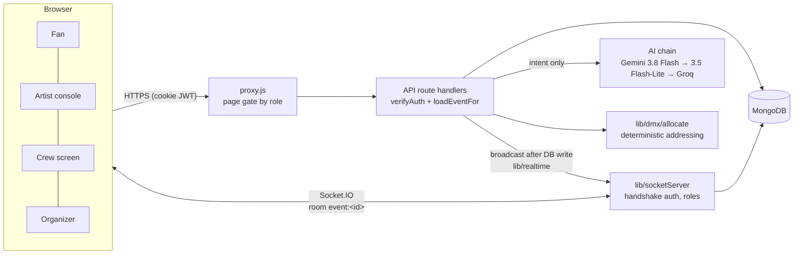

# ⚡ StageVerse

### *Bridging Live Event Production and Systems Engineering*


StageVerse is a full-stack platform for live concert production that connects the four groups behind a show: **fans**, **artists**, **organizers** and the **production crew**. Organizers publish shows, artists build setlists, tech riders and day sheets, crews patch lighting and track logistics, and during the show the artist's console, the crew's screens and fans' phones stay in sync in real time, including a live encore vote. It aims to cut the technical overhead, signal collisions and communication gaps of concert production for technical directors, systems engineers and front-of-house (FOH) crews.

**Live site: [stage-verse.vercel.app](https://stage-verse.vercel.app/)** | [LinkedIn](https://www.linkedin.com/in/priyansh-waghela-3b754b282/)

### Try it live

Sign in at [stage-verse.vercel.app/login](https://stage-verse.vercel.app/login) with any of these demo accounts (password `stageverse-demo`). They share one demo tour, so you can see the same shows from every side:

| Role | Email | Start here |
|---|---|---|
| Fan | `recruiter.fan@stageverse.demo` | Passport dashboard, Discover, Memories, Friends |
| Artist | `recruiter.artist@stageverse.demo` | Tour dashboard, setlist builder, tech rider, live show control |
| Organizer | `recruiter.organizer@stageverse.demo` | Events, ticket sales reports, create an event with AI copy |
| Production crew | `recruiter.crew@stageverse.demo` | Production dashboard, DMX patch studio (one show has an address clash to find), logistics board |

For the live sync, log in as the artist and the crew in two browser windows (one private), open the same show's live pages and start the show. The demo data is reset regularly.

Built with Next.js 16 (App Router), MongoDB/Mongoose, Socket.IO, React Three Fiber and Google Gemini.

---

## 🛠️ Core engineering features

### 1. Patch studio with collision-free DMX addressing
Manually assigning DMX addresses across many multi-channel moving heads invites errors that can stall a load-in.
* **The logic:** a deterministic allocator ([`lib/dmx`](lib/dmx)) places each fixture's channel footprint inside 512-channel universes (first fit), never splitting a fixture across a universe boundary, and a conflict check flags any overlapping footprints before anything is saved.
* **AI assistant:** a patch request in plain words ("patch 6 spots and 4 washes") goes to the LLM only for *intent*; the allocator computes the addresses, so collisions are impossible by construction (measured below).

### 2. Real-time FOH-to-backstage sync
Live shows change fast; the artist's console, the crew's cue screens and fans' phones must stay in lockstep.
* **The tech:** Socket.IO rooms per show, authenticated at the handshake with the session cookie.
* **The logic:** the server is the source of truth: clients request changes over HTTP, the server writes to MongoDB and *then* broadcasts to the show's room (p50 ≈ 3 ms push latency to 10 screens).
* **The show clock** is stored with the show (seconds banked plus when the current run started), so a screen that opens late or presses refresh is on the right second ([`docs/live-sync.md`](docs/live-sync.md)).

### 3. The homepage: a 3D concert you can run
A scroll-driven 3D concert (venue gate, full lighting rig, LED wall) that runs at 60 FPS on integrated graphics. Visitors can play a song (a demo, or their own, analysed in the browser for tempo, beats, sections and energy and programmed into a light show the way a lighting designer would), then run the lights themselves with one-tap controls or the full lighting desk. The scroll settles gently on each of its 10 sections, with small dots to jump between them. House lights light the venue in warm work light, as at the end of a real concert. On phones the scroll show plays and the playground asks for a bigger screen ([`docs/homepage-show.md`](docs/homepage-show.md)).

## What each role can do

| Role | Highlights |
|---|---|
| **Fan** | Passport dashboard, discover events, predict the setlist (scored after the show), vote in the live encore poll, memory vault (photos open full size), friends (who's going to your shows, follow fans) |
| **Artist** | Setlist builder, encore polls, live-show console (start/pause/last-song alert), tech rider with LD assignment, day sheet, guest list |
| **Organizer** | Create and manage events, AI-written event descriptions, reports and analytics |
| **Production crew** | Live cue screen synced to the artist, DMX patch studio with an AI patch assistant, logistics board, tasks |

---

## 🚀 Architecture



* **Frontend and API:** Next.js 16 (React 19) pages, with the API as Next.js route handlers (no separate Express server).
* **Database:** MongoDB via Mongoose.
* **Real-time layer:** Socket.IO attached to the Node server.
* **3D:** React Three Fiber / three.js.

Design decisions:
- **Every API route authenticates and authorizes itself.** A user's permissions on an event come from their *relation* to it (organizer / artist / assigned crew), not just their account role ([`lib/authz.js`](lib/authz.js)). The page proxy only decides which pages a role can open.
- **The server is the source of truth for live state.** Details, sequence diagram and numbers: [`docs/live-sync.md`](docs/live-sync.md).
- **AI requests are always answered.** Providers are tried in order (Gemini 3.8 Flash → Gemini 3.5 Flash-Lite → Groq `gpt-oss-120b`), and a provider that just hit overload or quota is skipped for a while (circuit breaker). If none answers, each feature falls back to something useful without AI: template copy, the artist's own song catalogue, a BPM energy curve for setlist order, or a rule-based reader for patch requests. Responses say `degraded: true` when that happens ([`lib/llm.js`](lib/llm.js)).
- **The LLM interprets, code computes.** The patch assistant asks the model only for intent (`{action, fixtures:[{type,count}]}`, JSON-schema constrained and validated, with one repair retry); the allocator assigns the addresses.
- **The 3D homepage fakes light instead of computing it.** Instanced real fixture models whose pan and tilt are solved in a vertex shader, additive cone beams (no real spotlights), each group of lights doing one job, about 31 draw calls, quality tiers with a live step-down and a 2D fallback.

---

## ⚙️ Run it locally (about 10 minutes)

**Prerequisites:** Node.js 22.9 or newer, a MongoDB database (local `mongod` or a free Atlas cluster), and optionally Gemini and/or Groq API keys for the AI features (without any, AI features use their non-AI fallbacks).

```bash
git clone https://github.com/Priyanshh1407/StageVerse.git
cd StageVerse
npm install
cp .env.example .env.local      # then fill in MONGODB_URI and JWT_SECRET (GEMINI_API_KEY / GROQ_API_KEY optional)
npm run seed -- --yes           # demo accounts and a full demo tour (shows, tickets, crew, patches)
npm run dev                     # http://localhost:3000
```

Testing accounts created by the seed script (password `password123`; the seed also creates the recruiter accounts above):

| Role | Email |
|---|---|
| Fan | `fan@stageverse.demo` |
| Artist | `artist@stageverse.demo` |
| Organizer | `organizer@stageverse.demo` |
| Production crew | `production@stageverse.demo` |

To see the live sync, open the artist's live-show page, the crew's live page and the fan dashboard for the seeded event in three browser windows.

**Deploying:** the site runs on Vercel. [`docs/DEPLOYMENT.md`](docs/DEPLOYMENT.md) covers environment variables, MongoDB Atlas, shipping and rolling back, seeding production and the checks to run after a deploy.

## Scripts

| Command | What it does |
|---|---|
| `npm run dev` / `build` / `start` | Next.js dev server / production build / production server |
| `npm test` | Full test suite against an in-memory MongoDB replica set (no network, no real DB) |
| `npm run test:coverage` | Tests with a coverage report for server code |
| `npm run lint` | ESLint (CI fails on any error) |
| `npm run seed -- --yes` | Seed demo data into the database in `.env.local` |
| `npm run bench` | Live-screen benchmark (endpoint latency, socket push latency) |
| `npm run analyse:song -- <file> <slug> <title>` | Analyse a song (tempo, beats, sections) and program its homepage light show ([docs](docs/homepage-show.md)) |
| `npm run song:bars -- <file>` | Bar-by-bar loudness, drum density, brightness and bass of a song, for annotating its structure by hand |
| `npm run eval:patch -- --provider groq` | AI patch-assistant evaluation, legacy vs current pipeline (~65 real API calls; `-- --fake` checks the harness without API calls) |

## Testing and quality

- **289 tests** (Vitest) covering authentication, an authorization matrix across roles and routes (including the cases that *must* still be allowed), voting integrity (20 concurrent votes from one fan count once), socket handshake auth and room isolation against a real Socket.IO server, prediction scoring, input validation, rate limiting, the DMX allocator (with property-based tests over random patches), the AI patch route with a scripted model, and the homepage show: song analysis (against a synthetic click track), the cue engine and every lighting-programming rule.
- **CI** ([`.github/workflows/ci.yml`](.github/workflows/ci.yml)) runs lint, tests with coverage, a production build and a dependency audit on every push.
- **Manual test guide:** [`docs/MANUAL_TESTING.md`](docs/MANUAL_TESTING.md) walks through every upgraded feature in the browser (including how to force each AI fallback level) and lists the automated test commands.
- The engineering history (each bug, how it was found, the fix and the trade-off) is in [`FIX_LOG.md`](FIX_LOG.md). The audit that started it is in [`PROJECT_AUDIT_REPORT.md`](PROJECT_AUDIT_REPORT.md).

## Measured

| What | Result | Source |
|---|---|---|
| Live-state requests, 10 crew screens | 10/s → 0.5/s (push first, 20 s reconcile) | `bench/results/` |
| Socket push latency to 10 screens | p50 ≈ 3 ms, p95 ≈ 5 ms | `bench/results/` |
| Setlist lookup | 2,001 → 1 documents examined (index) | `bench/results/` |
| Production dependency advisories | 19 → 1 (`xlsx`, write-only use, not reachable) | `npm audit --omit=dev` |
| AI patching: cases with colliding DMX addresses | 17% → **0%** (30-case eval, Groq gpt-oss-120b) | `evals/patch/results/` |
| AI patching: request understood correctly | 90% → **100%** (93% before one round of prompt fixes) | `evals/patch/results/` |
| AI patching: p50 / p95 latency | 1.3 / 2.1 s → **0.78 / 1.5 s** | `evals/patch/results/` |
| Homepage 3D stage on Intel Iris Xe (integrated) | ~89 real lights → 3 cheap fills; **60 FPS**, 58 FPS 1% low with bloom at native resolution | `bench/results/stage-*.json`, [docs](docs/homepage-show.md) |
| Song analysis: tempo | *A Sky Full of Stars* 125.1 BPM (published 125); *Yellow* 86.8 BPM (published ~87) | [docs](docs/homepage-show.md) |

## Known limitations

Written down on purpose: this is a portfolio project, and these are the honest edges.

- **Ticketing is on hold.** The purchase widget has a known crash (BUG-01), purchases don't issue tickets (BUG-02), and inventory updates aren't atomic (BUG-03). No real payments are taken. See "Parked: Ticketing" in [`UPGRADE_PLAN.md`](UPGRADE_PLAN.md).
- **Real-time needs one long-running Node server.** Socket.IO attaches to Next's HTTP server, so its pushes don't work on serverless hosts like Vercel, where the live screens fall back to re-syncing every 20 seconds and on refresh ([deployment guide](docs/DEPLOYMENT.md#7-known-limits-on-vercel)). Rooms are in-process (multiple instances would need the Socket.IO Redis adapter).
- **Rate limits are per process** (in-memory token buckets).
- **Free AI tiers are tight** (Gemini: 5 requests/minute and 20/day per model). The provider chain and non-AI fallbacks keep features working, but fallback answers are simpler; heavy AI use needs a billed key.
- **Accounts choose their own role at signup.** Fine for a demo; a real deployment would approve organizer and crew accounts.
- **Demo songs.** *A Sky Full of Stars* and *Yellow* (Coldplay) are commercial recordings, committed only so the homepage demo works and used for educational purposes only ([disclaimer](#disclaimer)); any other track stays local (gitignored). Their programmed shows and hand-annotated structures are in `public/shows/` (`<slug>.show.json`, `<slug>.extras.json`). "Light up your song" analyses any MP3/WAV/OGG/FLAC in the visitor's browser without uploading it.
- **Sentiment analysis isn't built.** The analysis page shows labelled sample data.
- The AI patch eval uses 30 cases I wrote, and the second prompt version was tuned on them, so its 100% intent accuracy is optimistic; a held-out case set is the next step. Gemini results are pending: the free tier's 20 requests/day per model is less than one full run.

## Disclaimer

This is a non-commercial portfolio project built for learning. The songs used in the homepage demo, *A Sky Full of Stars* and *Yellow* by Coldplay, are used for **educational, non-commercial purposes only**, to demonstrate the song analysis and light-show programming. All rights to the music belong to its respective owners (the artists, songwriters and labels). No ownership is claimed and nothing is sold. If you are a rights holder and want a track removed, contact me on [LinkedIn](https://www.linkedin.com/in/priyansh-waghela-3b754b282/) and it will be taken down. Fixture models and fonts are used under their own licences (see Credits).

## 🗺️ Roadmap

- [x] Collision-free DMX allocation with overlap checks, and an AI patch assistant on top of it.
- [x] Real-time show sync over Socket.IO with server-authoritative state.
- [x] 3D homepage concert with song analysis and automatic light-show programming.
- [ ] GrandMA3 patch export: serialize the patch to the console's `.xml` import format so it loads in grandMA3 onPC.
- [ ] Art-Net / sACN packet simulator to visualize DMX data transmission in the browser (universes mapped to UDP packets).
- [ ] RDM (Remote Device Management) telemetry, to simulate automated fixture monitoring.
- [ ] Ticketing (parked; see above).

## Project structure

```
app/            pages (grouped by role) and API route handlers (app/api)
components/     UI components by area (components/home/show and components/home/stage: the 3D homepage)
lib/            auth, authorization, errors, validation schemas, realtime, socket server, DMX allocator, LLM client, show engine (lib/show)
models/         Mongoose schemas
pages/api/socket/io.js   Socket.IO bootstrap (needs the Node server)
public/shows/   programmed light shows and hand-annotated structure for the demo songs
scripts/        seed (demo data and recruiter logins), song analysis and bar-by-bar tools
tests/          Vitest suites (unit, security, characterization)
bench/ evals/   performance benchmark and LLM evaluation harness
docs/           design notes, manual test guide, deployment guide
```

## Credits

3D fixture models (CC BY 4.0): "Moving Head Beam (high Poly)" by Lord Henry and "STROBO LIGHTING WASIS" by eventdesignws, both from Sketchfab. Details in [`public/fixtures/CREDITS.md`](public/fixtures/CREDITS.md).

## ⚖️ Contact

Developed by **Priyansh Waghela**, Information Technology Engineering student at Dwarkadas J. Sanghvi College of Engineering (DJSCE), Mumbai.

*For software architecture inquiries, placement collaborations, or professional outreach, connect on **[LinkedIn](https://www.linkedin.com/in/priyansh-waghela-3b754b282/)** or see my work on **[GitHub](https://github.com/Priyanshh1407)**.*
