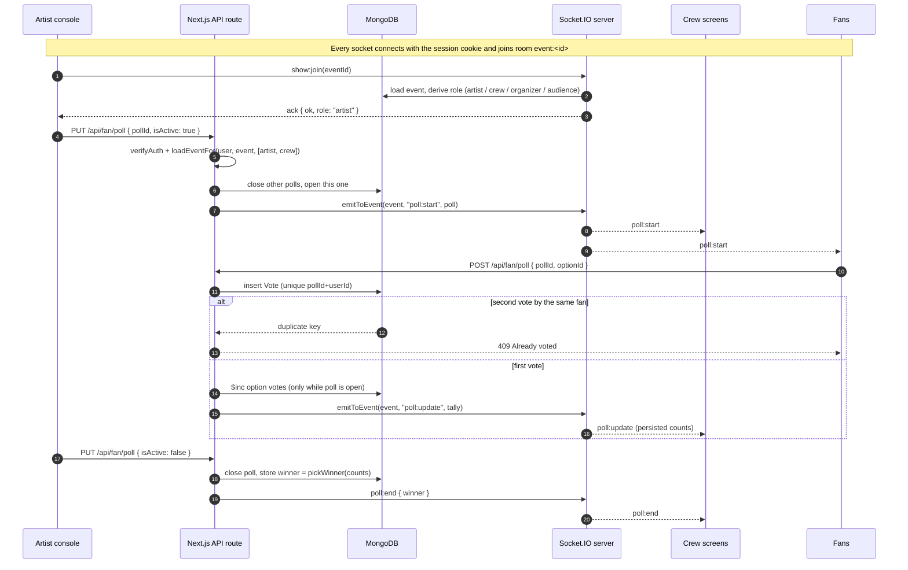

# Live-show sync

How the artist's console, the production crew's screens and fans' phones stay in sync during a show, and why it's built this way.

## The rule: the server is the only source of truth

Clients *ask* for changes over HTTP. The server checks who's asking, writes the change to MongoDB, and only then broadcasts it over Socket.IO to the show's room. A client never tells other clients what happened.

## Event protocol

Defined and validated in [`lib/liveProtocol.js`](../lib/liveProtocol.js).

| Event | Direction | Who may send | Payload |
|---|---|---|---|
| `show:join` / `show:leave` | client → server | any logged-in user | `eventId` (ack: `{ ok, role }`) |
| `show:update` | client → room | artist or crew of that show | `{ eventId, status?, time? }` (timer sync) |
| `poll:reveal` | client → room | artist or crew of that show | `{ eventId, winner }` |
| `show:update`, `show:warning` | server → room | `PUT /api/production/live` after saving | `{ eventId, status, warning, time }` (`time` = the show clock in seconds) |
| `poll:start`, `poll:update`, `poll:end` | server → room | `/api/fan/poll` after saving | `{ eventId, pollId, question, isActive, winner, options[] }` |

Anything else a client emits (for example the old `poll:vote`) is ignored. Malformed payloads get `error:invalid`; events from the wrong role get `error:forbidden`.

## Design decisions

**Authenticate the handshake, not just the HTTP routes.** WebSockets don't pass through Next.js middleware or route handlers, so before this the socket layer had no auth at all and anyone could emit `show:warning` to every screen. The handshake now verifies the same `token` cookie the API uses ([`lib/socketServer.js`](../lib/socketServer.js)).

**Roles come from the event, not the account.** An account with role `artist` is only `artist` in rooms for events where `event.artistId` is them. Everywhere else they're `audience`.

**One fan, one vote is a database constraint.** A unique index on `(pollId, userId)` rejects the second insert even when 20 requests arrive at the same instant (see `tests/security/voting.test.js`). A "check, then insert" in application code would let several through.

**Push first, poll to reconcile.** The crew screen used to poll every second *and* listen to sockets. Now pushes carry every change (p50 ≈ 3 ms to 10 screens). A 20-second poll, plus a refetch on every reconnect, catches anything missed while disconnected, since Socket.IO doesn't replay missed events. Measured in [`bench/live.bench.js`](../bench/live.bench.js):

| | Before | After |
|---|---|---|
| Requests/s, 10 crew screens | 10 | 0.5 |
| Setlist lookup docs examined (2,000 other shows) | 2,001 | 1 |
| Push latency p50 / p95 | 3.3 / 5.6 ms | 2.9 / 5.2 ms |
| Endpoint latency p50 / p95 | 14.3 / 19.1 ms | 13.6 / 17.6 ms |

The endpoint latency barely changed: at this data size a collection scan is cheap and per-request auth and lookup work dominates. The index keeps the lookup constant as setlists grow.

**The show clock lives on the server.** The setlist stores `clock: { elapsed, liveSince }`: the seconds banked
before the current run, and when the current run started ([`lib/showClock.js`](../lib/showClock.js)). While Live,
the time is `elapsed + (now − liveSince)`; Paused banks the time and clears `liveSince`; Standby resets it. When the
artist's console sends its own timer (`PUT /api/production/live { status, time }`), the clock follows it. Nothing is
written every second, yet any screen can compute the exact time: `GET /api/production/live` returns
`elapsedSeconds`, and every `show:update` carries `time`. The crew screen sets its timer from both, on open, on
reconnect, on the 20 s reconcile and when the **refresh button** next to ONLINE is pressed (it reloads the show
and says "Re-synced: back on track"). The artist's console also restores status and time when reopened. Before
this, leaving a show and coming back reset the timer to 0:00.

## Known limitations (and what I'd do at scale)

- **Single instance.** Rooms live in one Node process. With more than one server, I'd add the Socket.IO Redis adapter so a broadcast on instance A reaches sockets on instance B.
- **Needs a long-running server.** The Socket.IO server attaches to Next's HTTP server (`pages/api/socket/io.js`), which doesn't work on serverless hosts. The live site runs on Vercel, so its pushes don't reach other screens: screens converge through the 20 s reconcile, reconnect refetches and the refresh button, and the stored clock keeps the timer exact after each sync. For instant sync, deploy on an always-on Node host (Render, Railway, Fly.io), or run the socket server as its own service. See [`DEPLOYMENT.md`](DEPLOYMENT.md).
- **Vote tally vs. vote records.** The `Vote` insert and the tally `$inc` are separate writes. A crash between them undercounts by one, and the tally can be rebuilt from the `Vote` collection. I chose this over a transaction to keep vote latency low during a burst.
- **Any logged-in user can join as audience.** Ticket-gated rooms would come with the ticketing work (currently parked).
